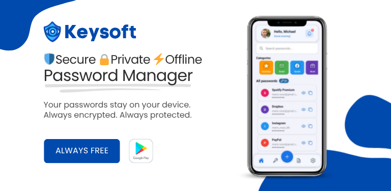
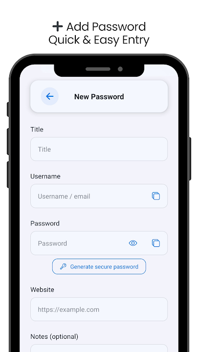
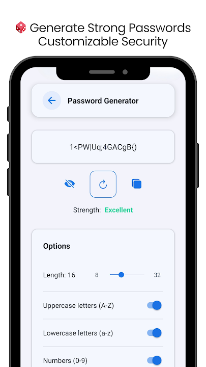
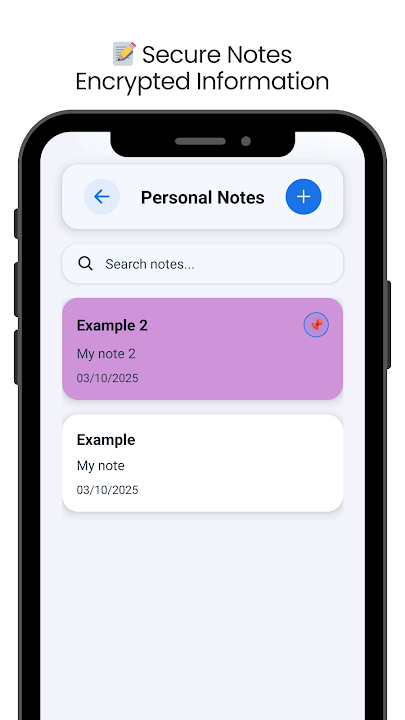
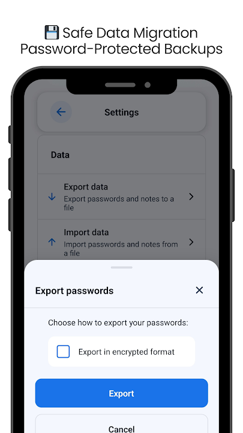

# Keysoft

A private, offline-first password manager for Android

[](https://github.com/TheStreamCode/keysoft/actions/workflows/ci.yml)
[](LICENSE)
[](https://play.google.com/store/apps/details?id=it.mikesoft.keysoft)



Keysoft keeps passwords and secure notes encrypted on the device and works without a
backend service. Network access is limited to platform update delivery, and vault contents,
PINs, master passwords and encryption keys are never synced or stored remotely. The app is
built for people who want a local password vault without an account, an ads business model
or an analytics pipeline.

## Install

Install Keysoft from [Google Play](https://play.google.com/store/apps/details?id=it.mikesoft.keysoft).

Android is the production platform. iPhone and iPad builds remain compatibility targets for
local testing and are not distributed through the Apple App Store. Source builds are produced
through EAS; see the [release guide](docs/release.md).

## Quick start

1. Install the app from Google Play and open it.
2. Set the master PIN when prompted. It is never stored or transmitted, and it cannot be
   reset by anyone, including the maintainer.
3. Add a password manually or generate one, then copy it with one tap. Copied secrets are
   cleared from the clipboard after 60 seconds by default.
4. Open Settings and export an encrypted backup. Keep the backup file and its passphrase
   somewhere safe and separate from the device.

## Features

- Private by default: no registration, cloud vault, advertising or analytics SDK.
- Works offline: create, search, organize and copy credentials without connectivity.
- Encrypted vault: authenticated KS1 encryption with tamper detection before decryption
  output is trusted.
- Optional biometric unlock backed by device-authenticated SecureStore.
- User-owned encrypted backups in the versioned `KS1-PW1` format, without a remote backup
  account.
- Practical security tools: password generator, vault-health checks, clipboard auto-clear,
  local reminders and optional screenshot protection.
- Accessible UI in Italian and English, light and dark themes, reduced-motion support, and
  phone and tablet layouts.
- Automatic locking after inactivity, with a 60-second default timeout.

### Product tour

The screenshots below are taken from the production Android listing on Google Play.

| Quick entry | Password generator | Secure notes | Encrypted backups |
| --- | --- | --- | --- |
|  |  |  |  |

## Requirements

- An Android phone or tablet. Keysoft is distributed through Google Play only.
- No account and no network connection are required for vault use.
- iOS builds are not distributed; they remain compatibility targets for simulator testing.

## Configuration

Keysoft needs no configuration file or environment variables. The settings below are available
inside the app; values shown are the defaults on a new installation.

| Setting | Purpose | Default |
| --- | --- | --- |
| Master PIN | Unlocks the vault and authenticates key derivation. | Set on first launch |
| Auto-lock timeout | Locks the vault after a period of inactivity. | 60 seconds |
| Biometric unlock | Stores the derived vault key in device SecureStore behind device authentication. | Off |
| Clipboard auto-clear | Clears a copied secret from the clipboard. | 60 seconds |
| Screenshot protection | Blocks screenshots and screen recording while the app is open. | Off |
| Language | Selects the Italian or English interface. | Device language |
| Theme | Selects light, dark or system appearance. | System |
| Password generator | Length and character classes for generated passwords. | 16 characters, all classes enabled, similar characters allowed |

## Privacy and security

Keysoft is local-first: no server, no sync, no analytics and no custom crash reporting. Vault
data uses the versioned KS1 envelope with AES-256-CBC encryption and HMAC-SHA256 integrity
verification; keys are derived with Argon2id in native builds, with a documented PBKDF2
fallback in Expo Go. A forgotten master PIN cannot be recovered by design, because no
server-side recovery material exists. Read the [security architecture](docs/security.md) for
the full model and the accepted trade-offs, the [privacy policy](https://mikesoft.it/en/keysoft-policy/)
for data handling, and `SECURITY.md` to report a vulnerability privately.

## Troubleshooting

### The master PIN is lost and the vault cannot be opened

There is no account, server or recovery back door, so no one can reset or reveal the PIN.
The only way back into a locked vault is a previously exported encrypted backup plus the
passphrase chosen at export.

### Biometric unlock stopped working

Unlock with the master PIN, then re-enable biometrics in Settings. Adding or removing a
fingerprint or face, changing the PIN, or a SecureStore failure disables biometric unlock and
falls back to PIN login; the vault itself is unaffected. Details are in the
[security architecture](docs/security.md#biometric-authentication).

### A backup import is rejected

The file is corrupt, the passphrase is wrong, or the file exceeds the 10 MiB import limit.
Imports are validated before anything is written, so a rejected import leaves the vault
unchanged. See [backup encryption](docs/security.md#backup-encryption).

### Expo Go behaves differently from the installed app

Expo Go builds use a documented PBKDF2 fallback because the native Argon2id module is not
available there; production builds derive keys with Argon2id. If a vault requires Argon2id
and the native module is missing, login fails with a native-KDF diagnostic instead of
silently accepting a weaker check.

## Development

Requirements: Bun 1.3.14, Node.js 22.13 or newer, and Expo Go on an Android device for
day-to-day development.

```bash
git clone https://github.com/TheStreamCode/keysoft.git
cd keysoft
bun install --frozen-lockfile
bun run start
bun run verify
bun run deps:audit
```

`bun run verify` runs formatting, type checking, linting, tests with coverage and
`expo-doctor`. Release artifacts are produced through EAS; build, submission, tag and release
operations are documented in the [development guide](docs/development.md) and the
[release guide](docs/release.md). Architecture notes live in [docs/architecture.md](docs/architecture.md).

## Support

See `SUPPORT.md` for the support policy. Product assistance is available at
[keysoft@mikesoft.it](mailto:keysoft@mikesoft.it); never include vault contents, PINs,
encryption keys or backup payloads in a support request.

## Contributing

See `CONTRIBUTING.md`. Keep security-sensitive changes small and testable, and run
`bun run verify` before requesting review.

## License

Keysoft is licensed under the [Apache License 2.0](LICENSE). See
[COPYRIGHT.md](COPYRIGHT.md), [THIRD_PARTY_NOTICES.md](THIRD_PARTY_NOTICES.md) and
[TRADEMARKS.md](TRADEMARKS.md) for first-party scope, dependency notices and trademark terms.

---

Maintained by [Michael Gasperini (Mikesoft)](https://mikesoft.it).
If this project is useful to you, consider [sponsoring its maintenance](https://github.com/sponsors/TheStreamCode).
